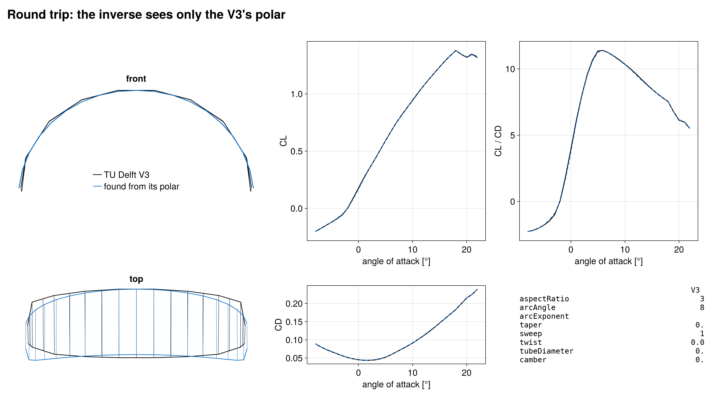
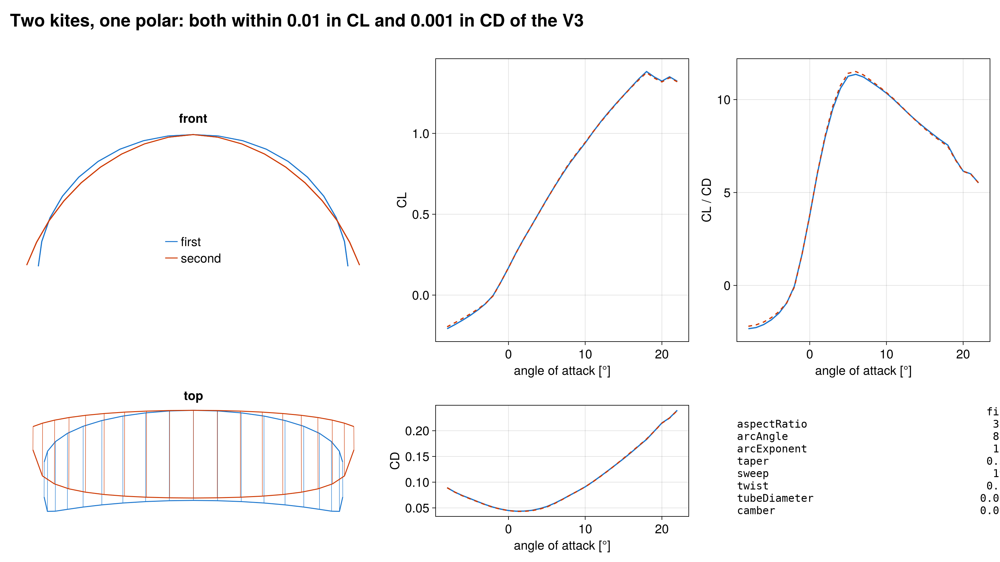
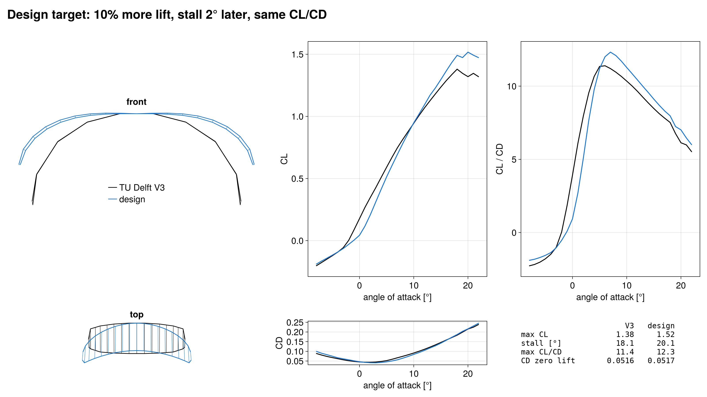
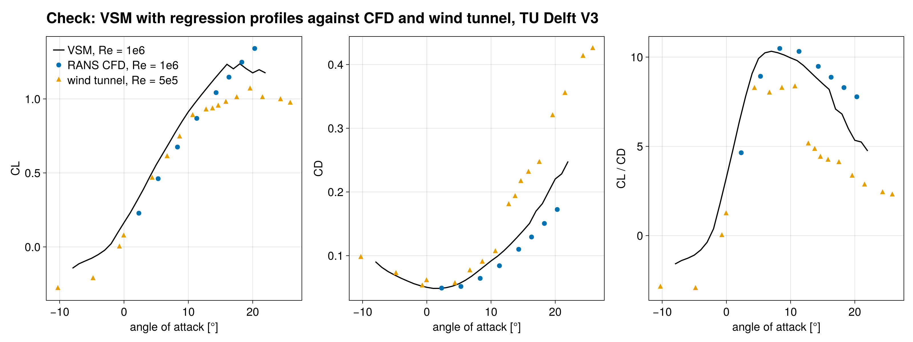

# Inverse design

The usual workflow draws a kite and computes its polar. Inverse design goes the other way: it starts from the polar a designer wants, CL and CD against angle of attack and where the kite stalls, and searches for the leading-edge-inflatable (LEI) kite geometry that produces it.

## The forward model

[`KiteShape`](@ref) describes a kite in the terms a designer uses, and [`kite_sections`](@ref) turns it into section leading and trailing edges:

```julia
shape = KiteShape(projected_area=19.5, aspect_ratio=3.6, arc_angle=88, arc_exponent=1.2,
                  taper=0.31, sweep=14, twist=0)
sections = kite_sections(shape; n_sections=19)   # sections.le, sections.te, sections.s
```

| parameter | meaning |
|---|---|
| projected area | area seen from above, held at the V3's 19.5 m² |
| aspect ratio | projected span squared over projected area |
| arc angle | angle of the arc's tangent from the horizontal at the tips |
| arc distribution | exponent `p` of the tangent angle `arc_angle * abs(s)^p`: 1 bends evenly, more keeps the centre flat |
| taper | tip chord over centre chord, the chord following `taper + (1 - taper) * sqrt(1 - s^2)` |
| leading-edge sweep | angle from the centre leading edge to the tip leading edge, seen from above; the leading edge moves back with `s^2` |
| twist | nose-down rotation of the tips about their leading edge, growing linearly with `abs(s)` |

`s` is the arc length from the centre over the half arc length, so the sections are evenly spaced along the arc. Each section carries the profile of Masure's regression for LEI airfoils at Re = 5e6, with the tube diameter and camber over the chord as two more design parameters. Both follow the V3's spanwise grading, scaled by their centre values. The regression's other four inputs are held at the centre of its training data.

VSM then computes the kite's polar from −8° to 22°, each angle solved from zero circulation. The angle of attack is measured to the centre chord.

## Running the examples

The examples need the regression models from [Zenodo](https://doi.org/10.5281/zenodo.16925758) (`ET_re5e6.pkl` and `ET_re1e6.pkl`, 2.3 GB each), converted once:

```bash
python scripts/export_masure_models.py ET_re5e6.pkl ET_re1e6.pkl --out data/masure
```

`data/masure` is the default; set `MASURE_MODELS_DIR` to read them from elsewhere. Then run the two examples, the table first, since the inverse starts from its sampled kites:

```bash
julia --project=examples -t auto examples/inverse_design_table.jl
julia --project=examples examples/inverse_design.jl
```

## Which parameters move which property

A step in each parameter, around the generator's closest fit to the V3, moves the polar's properties by:

| parameter, step | max CL | stall angle | max CL/CD | CD at zero lift |
|---|---|---|---|---|
| aspect ratio, 2.6 → 4.6 | +0.14 | −3.0° | +4.1 | 0.000 |
| arc angle, 82.5° → 94.5° | +0.03 | −0.1° | +0.5 | +0.004 |
| arc distribution, 0.7 → 1.7 | +0.08 | −1.8° | −0.6 | −0.016 |
| sweep, 5.9° → 21.9° | +0.03 | 0.0° | +0.4 | −0.002 |
| twist, −4° → +4° | −0.09 | +2.0° | −0.7 | +0.001 |
| taper, 0.16 → 0.46 | −0.03 | +1.0° | −0.1 | +0.002 |
| camber, 0.065 → 0.125 | +0.26 | +1.0° | −1.1 | +0.023 |
| tube diameter, 0.057 → 0.097 | −0.01 | 0.0° | −0.8 | +0.004 |

Camber dominates maximum lift and the drag at zero lift, but geometry is not frozen out of either: aspect ratio, twist and the arc's distribution move the stall angle by 2° to 3°, and the arc's distribution moves the zero-lift drag nearly as much as camber does. Both profile parameters therefore stay in the search.

## Round trip

The generator reproduces the V3's ribs to 0.16 m RMS over all leading and trailing edges, on an 8.3 m span. Handed only the V3's polar, the inverse returns a kite whose polar matches it to 0.004 in CL and 0.0004 in CD (RMS over −8° to 22°):



| parameter | V3 (fit) | found from its polar |
|---|---|---|
| aspect ratio | 3.55 | 3.66 |
| arc angle | 88.5° | 83.8° |
| arc distribution | 1.20 | 1.10 |
| taper | 0.31 | 0.39 |
| sweep | 13.9° | 17.2° |
| twist | 0.0° | 0.4° |
| tube diameter / chord | 0.077 | 0.063 |
| camber / chord | 0.095 | 0.098 |

Aspect ratio, arc distribution, twist and camber come back within a few percent. Tube diameter, taper and sweep do not, because the polar barely depends on them.

## How unique the answer is

Started from the twelve sampled kites whose polars come closest to the V3's, the inverse returns six kites that all match it within 0.01 in CL and 0.001 in CD. Their camber lies between 0.096 and 0.105 and their aspect ratio between 3.6 and 4.1, but their sweep runs from 6° to 21°, their arc angle from 70° to 88° and their taper from 0.26 to 0.40. The two most different of them fly within 0.005 in CL and 0.0005 in CD of each other:



A polar fixes camber, aspect ratio and how the arc is distributed. It leaves sweep, taper and tip angle to the designer, who can set them for reasons VSM does not see, such as bridle geometry, steering response or how the kite deforms.

## A design target

The target asks for 10% more maximum lift than the V3 and stall 2° later, without losing maximum CL/CD or adding zero-lift drag. Past the target the inverse charges the change from the V3, so it returns the smallest change that meets it:



| property | V3 | target | design |
|---|---|---|---|
| max CL | 1.380 | ≥ 1.518 | 1.518 |
| stall angle | 18.1° | ≥ 20.1° | 20.1° |
| max CL/CD | 11.4 | ≥ 11.4 | 12.3 |
| CD at zero lift | 0.0516 | ≤ 0.0516 | 0.0517 |

The design has aspect ratio 4.4, a flatter centre with curled tips (arc distribution 2.25 at 79°), 28° of sweep, 4.6° of washout, more camber (0.118) and a thinner tube (0.061). It meets three targets and misses the zero-lift drag by 0.00007.

## What the result does and does not show

- VSM computes the kite's design shape, rigid and at one Reynolds number. A flying LEI kite deforms under load, and its canopy billows between the struts, so the shape that flies is not the shape drawn here.
- VSM's lifting-line model is most trustworthy before stall. Past stall the solution depends on the starting circulation, so the polars are solved from zero circulation at every angle, and the stall angle is the angle of maximum CL in that sweep.
- The profiles come from a regression trained on 2D RANS CFD. Its output changes in steps, it returns its edge values outside the training range, and four of its six inputs are held at the centre of the training data.
- A second profile model is a partial check that the design is not an artefact of the regression's steps. With Breukels' LEI regression in every section instead, the design still beats the V3: max CL 1.51 against 1.40, stall 18.8° against 16.6°, max CL/CD 8.0 against 7.4 and zero-lift CD 0.050 against 0.054.
- An independent check of the forward model needs measurements of a real kite. The TU Delft V3 has them. With the regression's Re = 1e6 model, VSM reads CL 0.11 higher than RANS CFD at Re = 1e6 below stall (6 points), and CD 0.014 higher. Against the Re = 5e5 wind tunnel it reads CL 0.13 higher and CD 0.035 lower (12 points). The bias is mostly an offset, so comparisons between kites hold up better than the absolute numbers:



- An independent check of the design itself needs a RANS simulation of its 3D shape, or a model in a wind tunnel. Neither is in this repository.

## Choosing the table's size

The table samples 65 536 kites evenly over the parameter ranges, and 60 213 of them show all four properties between −8° and 22°. Nearest match over all of them makes the kite jump: as one slider moves across its range in 100 steps, the parameters change by more than 10% of their ranges 26 times. Instead, the property space is divided into cells, and each occupied cell keeps the kite closest to the V3, so neighbouring cells hold kites changed from the V3 in similar ways. Fewer cells mean fewer jumps but a coarser match to the slider:

| cells per property | kites | jumps per slider sweep | median slider miss |
|---|---|---|---|
| all | 60 213 | 26.1 | 1.6% |
| 6 | 440 | 6.5 | 5.2% |
| 8 | 1 052 | 8.2 | 4.2% |
| 10 | 2 023 | 10.1 | 3.6% |
| 12 | 3 393 | 11.6 | 3.3% |
| 16 | 7 525 | 14.2 | 2.7% |

The table keeps 10 cells per property, 2 023 kites in 0.9 MiB. The slider miss is the distance from the slider to the picked kite's property, as a share of the property's range, over 400 sweeps from settings drawn from the table.

## The table for the interactive page

`docs/src/assets/inverse_design_kites.json.gz` is one gzipped JSON object:

| field | content |
|---|---|
| `source` | one line naming where the table comes from |
| `alpha` | angles of attack [°] every polar is given at |
| `parameters` | the design parameters in display order, each `{key, label, unit}`; angles in degrees |
| `designs` | the sampled kites, see below |
| `reference` | the TU Delft V3, as a design plus `name`; its `parameters` are the generator's closest fit to it, its `sections` its own ribs |

Each design holds:

| field | content |
|---|---|
| `parameters` | `{key: value}` for every entry of `parameters` |
| `properties.clMax` | maximum CL |
| `properties.stallAngle` | angle of attack of maximum CL [°], refined by a parabola through its neighbours |
| `properties.maxLiftToDrag` | maximum CL/CD |
| `properties.cdZeroLift` | CD where CL crosses zero |
| `cl`, `cd` | the polar at `alpha`; `null` where VSM did not converge |
| `sections` | `[{le: [x, y, z], te: [x, y, z]}]` [m], from the left tip to the right tip; x downstream, y to the right tip, z up, the centre leading edge at the origin |
